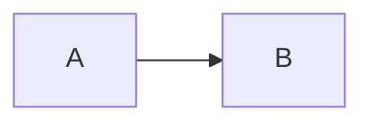
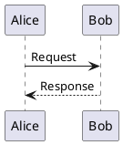

# spec-review

A read-only terminal and browser application for reviewing and comparing specifications stored as YAML artifacts and generated Markdown, from local folders or repositories accessible through `gh`.

## Install and run

Requires Python 3.12+ and [uv](https://docs.astral.sh/uv/). From a project containing this submodule:

```sh
git submodule update --init spec-review
cd spec-review
npm ci --prefix frontend
npm run build --prefix frontend
uv sync --locked
uv run spec-review --repo ..
```

Run the browser interface against the same local folder:

```sh
uv run spec-review --web --repo /path/to/project --spec-dir spec
```

It listens on `127.0.0.1:8765` by default. The WebUI is read-only and supports local working-tree browsing and Git comparisons. To expose it on another interface, pass `--host` and `--port`.

### GitHub repositories through gh

Install [GitHub CLI](https://cli.github.com/) and sign in on the machine running the WebUI with `gh auth login`. The overview's **Add** action lists repositories available to that account. Saved repositories appear in the left sidebar; their branches, commits, pull requests, and available Actions state can be reviewed in the browser. Revision files are fetched into a local bare Git mirror. GitHub App credentials and direct Python GitHub API access are not used.

The server uses the signed-in `gh` account for every browser visitor. Keep this version on a trusted local interface; a hosted multiuser version needs a separate access model.

The browser frontend is implemented in Svelte. Its compiled static assets are served by the Python server; the document API reuses the TUI's field formatting, link resolver, and local diagram renderer. Markdown links and relationship IDs navigate within the selected snapshot, while source metadata and pre/postcondition lists keep their TUI formatting.

### Frontend development

Install frontend dependencies once with `npm ci --prefix frontend`. Run the Python API and Vite in separate terminals from the project root:

```sh
uv run spec-review --web --repo . --spec-dir spec
cd frontend && npm run dev
```

Open `http://127.0.0.1:5173`. Vite proxies `/api` requests to the Python server on port 8765 and reloads Svelte and CSS changes as you edit. To run browser regression tests, install Playwright Chromium with `cd frontend && npx playwright install chromium`, then run `npm run test:e2e`. For production assets, run `npm run build` in `frontend`; Vite writes ignored output to `frontend/dist`, which the Python server serves. Build frontend assets before building a Python wheel.

The private submodule requires GitHub authentication. By default, the CLI uses the current directory as the repository and `./spec/` as the specification directory. Override the spec folder with `--spec-dir`, or select another repository with `--repo`:

```sh
uv run --project /path/to/spec-review spec-review --repo /path/to/project --spec-dir spec
```

For a standalone installation, `uv tool install /path/to/spec-review` exposes `spec-review` on your PATH. Use `--repo` when invoking that installation outside the specification repository.

## Review spec-review itself

The tool's own [specification](spec/README.md) captures the original requirements and decisions from the project conversation, with linked artifacts, acceptance scenarios, and maintained views.

From the `spec-review` directory, select this repository explicitly:

```sh
uv run spec-review --repo .
```

Regenerate its visual previews and overviews after changing canonical artifacts with:

```sh
node scripts/render_spec_mockups.mjs
uv run python scripts/validate_spec_views.py
```

## Specification format

See the [artifact format and field display reference](docs/artifact-format.md) for supported keys, special rendering rules, comparison behavior, and validation.

- `spec/artifacts/**/*.yaml` (or `.yml`): one artifact per file, with string `id`, `type`, and `title`. All other fields are retained. Stable IDs identify documents across revisions and file moves.
- Supported types: `goal`, `actor`, `use_case`, `requirement`, `constraint`, `decision`, `design`, `test`, `risk`, `assumption`, and `question`. Additional types get their own category.
- Relationship fields (`actors`, `goal_refs`, `derived_from`, `related`, `addresses`, `decisions`, `verifies`) contain artifact IDs and appear as navigable links.
- `spec/views/**/*.md`: maintained overviews, displayed and compared as committed. Historical `spec/generated/` files remain readable where no matching view exists.
- Optional `source: {file, section}` metadata resolves links retained from old source documents into migrated artifacts. Ambiguous targets open a chooser. Missing targets show an explanation; legacy documents are never loaded.
- Malformed artifacts and duplicate IDs appear in Diagnostics. Duplicate IDs cannot be link targets. Input errors are indicated during comparisons; classifications for invalid documents should be reviewed alongside their diagnostics.

Descriptions accept Markdown and multiple diagrams, interspersed with prose:

````markdown
Some explanation.



Another diagram:


````

Standalone `@startuml` / `@enduml` blocks are also supported. Diagram source stays readable alongside images. Historical `rendered_diagram` fields are displayed as plain source, with no special rendering behavior. JSON descriptions identified by `source.file` are displayed as code.

## Navigation

| Control | Action |
|---|---|
| Mouse | Select categories/artifacts, click links and buttons |
| Tab / Shift+Tab | Move focus between controls |
| F6 | Cycle content, artifact list, and categories |
| Arrow keys | Navigate the focused list/categories; scroll focused content |
| Page Up / Page Down | Scroll focused content |
| `/` | Search the current artifact list by ID/title |
| `]` / `[` | Select next/previous content link; highlight its block and show its target |
| Enter | Follow the selected content link when content has focus |
| Alt+Left | Return to the previous artifact, version, and scroll position |
| `d` | Open commit comparison |
| `o` | Open Options |
| Ctrl+B | Return to working-tree browsing |
| Ctrl+R | Reload current browsing/comparison snapshots |
| `q` | Quit |

Categories include empty artifact types and Overviews. Diff and Options are available in the bottom tabs and toolbar. Small terminals retain horizontal category scrolling.

## Git comparisons

The Diff modal lists commit SHA, date, and subject. Search subjects or enter a SHA, select a row, then use **Set base** (`b`) and **Set target** (`t`). Enter assigns base, then target. Previous/Next page through history. **Compare** activates the selection; Escape/Cancel keeps the current view.

Default revisions are `HEAD^` and `HEAD` (or `HEAD` twice for a repository with one commit). Reversed selections and identical commits are supported. A commit before the specification was introduced represents an empty specification.

The artifact list retains deleted artifacts. Additions are green `+`, changes orange `~`, and deletions red `−`. Use **Changes only** to hide unchanged artifacts during a comparison. Changed categories have a star. A type change is visible under both categories. YAML formatting, mapping order, and file relocation do not count as changes; field types, list order, and field content do. Generated Markdown uses textual comparisons.

Inline diffs show line hunks within named fields with unchanged context. Two-panel diffs align base and target rows in one shared scroll viewport. Links use the version from which they appear; following a removed link shows the base artifact explicitly. Alt+Left returns to the comparison.

Inline diagram images use only target blocks, while removed diagrams remain source text. Two-panel mode shows each side's diagrams. Diagram source changes stay visible in both modes.

Git objects are read directly. The tool does not check out commits, change branches, fetch, or write specification files.

## Diagrams and settings

Image display requires [Kitty](https://sw.kovidgoyal.net/kitty/). Unsupported terminals show source instead. Images use the terminal graphics protocol through [textual-image](https://github.com/lnqs/textual-image); rendering does not use a remote server.

Install `plantuml` (including Java and Graphviz as required by your diagrams) and the [Mermaid CLI](https://github.com/mermaid-js/mermaid-cli) (`mmdc`) locally. Mermaid needs Chromium: the tool honors a configured executable or `PUPPETEER_EXECUTABLE_PATH`, otherwise detects system `chromium`, `chromium-browser`, or `google-chrome`. If none is found, `mmdc` uses its own browser installation. PlantUML runs with Java's headless mode enabled.

Options persist rendering, diff layout, executable paths, Chromium selection, and renderer timeout. Defaults are rendering enabled, inline diff, and a 30-second timeout. Disabling rendering cancels active jobs and prevents new renderer invocations and image display. Renderer failures show source and an error without blocking other documents.

Settings: `$XDG_CONFIG_HOME/spec-review/settings.json`, default `~/.config/spec-review/settings.json`.

Diagram PNG cache: `$XDG_CACHE_HOME/spec-review/diagrams/`, default `~/.cache/spec-review/diagrams/`. Keys include source, language, renderer identity/version, and browser configuration. Remove this directory to clear the cache. No configuration or image cache is written into the specification repository.

## Backend API

The backend imports independently of Textual. A small read-only HTTP server is available with `--web`; frontend code can also adapt these services directly:

```python
from pathlib import Path
from spec_review.repository import Repository
from spec_review.content import compare, document_blocks
from spec_review.links import LinkResolver

repo = Repository(Path("/path/to/project"), "spec")
working = repo.load()                 # Working tree
base = repo.load("HEAD^")            # Immutable Git snapshot
target = repo.load("HEAD")
comparison = compare(base, target)
payload = comparison.to_dict()        # JSON-serializable models
document = working.documents["GOAL-001"]
sections = document_blocks(document)
result = LinkResolver(working).resolve(document, "UC-001")
```

`DiagramRenderer.render(Block)` asynchronously returns a local PNG path or diagnostic. Models carry snapshot provenance, fields, content blocks, and change statuses; frontend code owns terminal colors and widgets.

## Development

```sh
uv sync --locked
uv run pytest
uv run ruff check src tests
uv run ruff format --check src tests
```

Rebuild the bundled Svelte frontend after changing `frontend/`:

```sh
cd frontend
npm ci
npm run build
```

Tests use temporary Git repositories, Textual Pilot, and renderer doubles. For image QA, launch in Kitty and inspect multi-diagram descriptions and maintained views while scrolling, resizing, following links, opening dialogs, disabling rendering, and switching diff layouts. Verify that removed inline diagrams have source only, and that images disappear when navigating away.

To update a consuming project, pull a committed release inside the submodule, then commit its gitlink in the parent repository. Fresh clones can use `git clone --recurse-submodules`.
