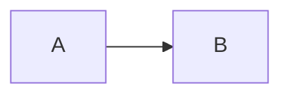
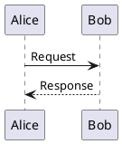

# spec-review

A read-only browser application for reviewing and comparing specifications stored as YAML artifacts and maintained Markdown views, from local folders or repositories accessible through `gh`.

## Installation

Requires Python 3.12+ and [uv](https://docs.astral.sh/uv/). Install from a
checkout to make `spec-review` available on your PATH:

```sh
uv tool install /path/to/spec-review
```

For development, use an editable installation so Python source changes take
effect without reinstalling:

```sh
uv tool install --editable /path/to/spec-review
```

Run `uv tool update-shell` if uv's tool executable directory is not yet on your
PATH. Build the frontend as described below before installing if you need the
browser interface.

## Run from a checkout

Requires Python 3.12+ and [uv](https://docs.astral.sh/uv/). From a project containing this submodule:

```sh
git submodule update --init spec-review
cd spec-review
npm ci --prefix frontend
npm run build --prefix frontend
uv sync --locked
uv run spec-review
```

Run the browser interface, then use **Add repository → Local folder** to select a folder:

```sh
uv run spec-review
```

It listens on `127.0.0.1:8765` by default. The WebUI saves multiple local folders and GitHub repositories. Its folder browser starts at the server user’s home and supports parent navigation and direct path entry, with a relative spec directory defaulting to `spec`. Plain folders support current-file review. Local Git repositories show worktree cards like PRs: choose a base branch, then open a card to compare committed and uncommitted specification changes without switching branches. Ordinary comparisons default to the default branch (local `origin/HEAD`, then `main`, `master`, `HEAD`); explicit PR comparisons keep their base/head. Use Refresh to rediscover worktrees and Apply revision to reread current files. The WebUI is read-only. To expose it on another interface, pass `--host` and `--port`.

### GitHub repositories through gh

Install [GitHub CLI](https://cli.github.com/) and sign in on the machine running the WebUI with `gh auth login`. The overview's **Add repository** dialog offers a folder browser for local folders and lists GitHub repositories available to that account. Local folders do not require gh authentication. Saved repositories appear in the left sidebar; their branches, commits, pull requests, and available Actions state can be reviewed in the browser. Revision files are fetched into a local bare Git mirror. GitHub App credentials and direct Python GitHub API access are not used.

The server uses the signed-in `gh` account for every browser visitor. Keep this version on a trusted local interface; a hosted multiuser version needs a separate access model.

The browser frontend is implemented in Svelte. Its compiled static assets are served by the Python server; the document API provides field formatting, link resolution, and local diagram rendering. Markdown links and relationship IDs navigate within the selected snapshot, while source metadata and pre/postcondition lists retain their formatting.

### Frontend development

See [frontend component and verification conventions](frontend/README.md) for reusable controls, scoped styling, and live dialog layout checks.
Start the component catalog with `npm run storybook --prefix frontend`; it previews the same Svelte UI components used by the browser application.

Install frontend dependencies once with `npm ci --prefix frontend`. Run the Python API and Vite in separate terminals from the project root:

```sh
uv run spec-review
cd frontend && npm run dev
```

Open `http://127.0.0.1:5173`. Vite proxies `/api` requests to the Python server on port 8765 and reloads Svelte and CSS changes as you edit. To run browser regression tests, install Playwright Chromium with `cd frontend && npx playwright install chromium`, then run `npm run test:e2e`. For production assets, run `npm run build` in `frontend`; Vite writes ignored output to `frontend/dist`, which the Python server serves. Build frontend assets before building a Python wheel.

Live GitHub checks are opt-in and read-only. Authenticate a dedicated test account into an isolated config directory, then run the checks with the expected login. Set `SPEC_REVIEW_LIVE_GH_REPO` to a dedicated repository to exercise branch, pull request, commit, snapshot, and comparison routes:

```sh
GH_CONFIG_DIR="$PWD/.gh-config" gh auth login --hostname github.com --web
GH_CONFIG_DIR="$PWD/.gh-config" gh auth status --hostname github.com
SPEC_REVIEW_LIVE_GITHUB=1 \
SPEC_REVIEW_LIVE_GH_CONFIG_DIR="$PWD/.gh-config" \
SPEC_REVIEW_LIVE_GH_LOGIN=test-account \
SPEC_REVIEW_LIVE_GH_REPO=test-account/spec-review-fixture \
uv run pytest -m live_github
```

These tests reject token environment overrides, use only GitHub reads and Git fetches, bind the test server to loopback, and place the Git mirror cache under pytest's temporary directory. Ordinary test runs skip them.

Kit commands accept `--repo` when invoked outside the specification repository.

## Add a specification to another project

Install the tool separately or invoke it from this checkout with `uv run spec-review`:

```sh
spec-review init --repo /path/to/project --dry-run
spec-review init --repo /path/to/project
spec-review validate --repo /path/to/project
spec-review update --repo /path/to/project --dry-run
```

Initialization installs a committed kit of references under `spec/docs/spec-review/`,
workflows under `.agents/skills/`, a minimal root instruction block, and an empty `spec/`
scaffold. Existing application files and project specification content are preserved.
A reviewer submodule is optional. Use `--spec-dir` for a custom spec directory; its
references and kit state move with it. Updates migrate older kits while preserving
local customizations and provide an update skill for conflicts.
See [setup and update instructions](spec/docs/spec-review/setup.md).

## Review spec-review itself

The tool's own [specification](spec/README.md) captures the original requirements and decisions from the project conversation, with linked artifacts, acceptance scenarios, and maintained views.

Start the server, then add the `spec-review` directory through the browser:

```sh
uv run spec-review
```

Regenerate its visual previews and overviews after changing canonical artifacts with:

```sh
node scripts/render_spec_mockups.mjs
uv run python scripts/validate_spec_views.py
```

The renderer uses the built Storybook catalog for browser UI previews. Build it with `npm run build --prefix frontend` and `npm run build-storybook --prefix frontend` first.

## Specification format

See the [artifact format and field display reference](spec/docs/spec-review/artifact-format.md) for supported keys, special rendering rules, comparison behavior, and validation.

- `spec/artifacts/**/*.yaml` (or `.yml`): one artifact per file, with string `id`, `type`, and `title`. All other fields are retained. Stable IDs identify documents across revisions and file moves. For new artifacts, follow the [canonical type-folder layout](spec/docs/spec-review/artifact-authoring.md#canonical-storage-layout) and use `<id>.yaml` filenames.
- Supported types: `goal`, `actor`, `use_case`, `requirement`, `constraint`, `decision`, `design`, `ui_design`, `test`, `risk`, `assumption`, and `question`. Additional types get their own category. See the [artifact authoring guide](spec/docs/spec-review/artifact-authoring.md) for what belongs in each type.
- Relationship fields (`actors`, `goal_refs`, `derived_from`, `related`, `addresses`, `decisions`, `verifies`) contain artifact IDs and appear as navigable links.
- `spec/views/**/*.md`: maintained overviews, displayed and compared as committed. Historical `spec/generated/` files remain readable where no matching view exists.
- Optional `source: {file, section}` metadata resolves links retained from old source documents into migrated artifacts. Ambiguous targets open a chooser. Missing targets show an explanation; legacy documents are never loaded.
- Malformed artifacts and duplicate IDs appear in Diagnostics. Duplicate IDs cannot be link targets. Input errors are indicated during comparisons; classifications for invalid documents should be reviewed alongside their diagnostics.

Descriptions accept Markdown and multiple diagrams, interspersed with prose:

````markdown
Some explanation.



Another diagram:


````

Standalone `@startuml` / `@enduml` blocks are also supported. Diagram source stays readable alongside images. Historical `rendered_diagram` fields are displayed as plain source, with no special rendering behavior. JSON descriptions identified by `source.file` are displayed as code.

## Git comparisons

Choose **Compare**, select base and target revisions, and apply the selection. Identical and reversed revisions are supported. A commit before the specification was introduced represents an empty specification.

The artifact list retains deleted artifacts. Additions are green `+`, changes orange `~`, and deletions red `−`. Use **Changes only** to hide unchanged artifacts during a comparison. Changed categories have a star. A type change is visible under both categories. YAML formatting, mapping order, and file relocation do not count as changes; field types, list order, and field content do. Generated Markdown uses textual comparisons.

Comparison panes align base and target content. Links retain the revision from which they appear.

Local Git objects and worktree files are read directly. Local review does not check out commits, change branches, fetch, or write specification files. GitHub review may fetch into its cache mirror.

## Diagrams and settings

Install `plantuml` (including Java and Graphviz as required by your diagrams) and the [Mermaid CLI](https://github.com/mermaid-js/mermaid-cli) (`mmdc`) locally. Mermaid needs Chromium: the tool honors a configured executable or `PUPPETEER_EXECUTABLE_PATH`, otherwise detects system `chromium`, `chromium-browser`, or `google-chrome`. If none is found, `mmdc` uses its own browser installation. PlantUML runs with Java's headless mode enabled.

Renderer failures show source and an error without blocking other documents.

Settings: `$XDG_CONFIG_HOME/spec-review/settings.json`, default `~/.config/spec-review/settings.json`.

Diagram PNG cache: `$XDG_CACHE_HOME/spec-review/diagrams/`, default `~/.cache/spec-review/diagrams/`. Keys include source, language, renderer identity/version, and browser configuration. Remove this directory to clear the cache. No configuration or image cache is written into the specification repository.

## Backend API

A read-only HTTP server serves the browser by default; frontend code can also adapt these services directly:

```python
from pathlib import Path
from spec_review.repository import Repository
from spec_review.content import compare, document_blocks
from spec_review.links import LinkResolver

repo = Repository(Path("/path/to/project"), "spec")
working = repo.load()                 # Working tree
base = repo.load("HEAD^")            # Immutable Git snapshot
target = repo.load("HEAD")
comparison = compare(base, target)
payload = comparison.to_dict()        # JSON-serializable models
document = working.documents["GOAL-001"]
sections = document_blocks(document)
result = LinkResolver(working).resolve(document, "UC-001")
```

`DiagramRenderer.render(Block)` asynchronously returns a local PNG path or diagnostic. Models carry snapshot provenance, fields, content blocks, and change statuses; the browser owns presentation and interaction.

## Development

```sh
uv sync --locked
uv run pre-commit install
uv run pytest
uv run pre-commit run --all-files
```

The pre-commit hooks run Ruff lint fixes and formatting on staged Python files.
If they modify files, review and stage the changes before committing again.

Rebuild the bundled Svelte frontend after changing `frontend/`:

```sh
cd frontend
npm ci
npm run build
```

Tests use temporary Git repositories, browser tests, and renderer doubles.

To update a consuming project, pull a committed release inside the submodule, then commit its gitlink in the parent repository. Fresh clones can use `git clone --recurse-submodules`.
