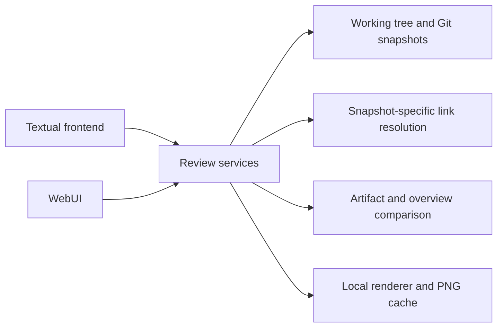
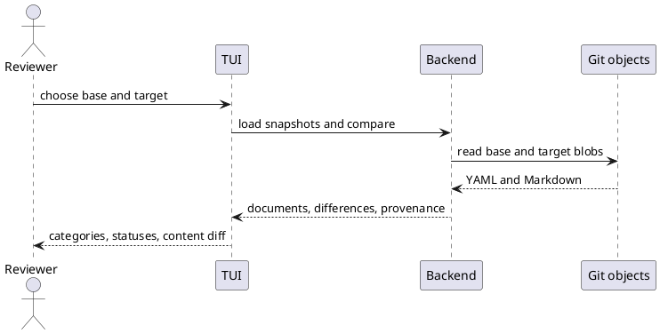

> GENERATED FILE — DO NOT EDIT.
> Source: spec/artifacts/. Regenerate with `uv run python scripts/generate_spec_views.py`.

# Design

## [DES-001](../artifacts/design/DES-001.yaml) — Reusable review backend and frontend boundary

### Description

The backend owns repository snapshots, canonical document models, relationship/link resolution, field comparisons, and diagram rendering. The terminal frontend owns layout, focus, selection, colors, dialogs, and Kitty image presentation. The WebUI uses the same backend services without importing Textual into the backend.

The following sequence shows a commit comparison through the same boundary.

### Addresses

[REQ-016](../artifacts/requirements/REQ-016.yaml), [REQ-022](../artifacts/requirements/REQ-022.yaml), [REQ-023](../artifacts/requirements/REQ-023.yaml), [REQ-027](../artifacts/requirements/REQ-027.yaml), [REQ-028](../artifacts/requirements/REQ-028.yaml)

### Decisions

[ADR-001](../artifacts/decisions/ADR-001.yaml)

### Source

`spec/sources/chat.md` — [Approved implementation plan](provenance.md#approved-implementation-plan)

## [DES-002](../artifacts/design/DES-002.yaml) — Terminal review workspace

### Description

Use an artifact list and search sidebar on the left and a main content pane on the right, and scrollable category tabs along the bottom. Include Overviews, Diff, and Options. Render prose and headings with terminal Markdown styling. Support mouse selection, Tab and F6 focus movement, arrows, content scrolling, ID/title search, previous/next link selection, Enter activation, and navigation history. Status colors are supplemented by +, ~, and − markers.

### Addresses

[REQ-002](../artifacts/requirements/REQ-002.yaml), [REQ-029](../artifacts/requirements/REQ-029.yaml), [REQ-004](../artifacts/requirements/REQ-004.yaml), [REQ-005](../artifacts/requirements/REQ-005.yaml), [REQ-006](../artifacts/requirements/REQ-006.yaml), [REQ-007](../artifacts/requirements/REQ-007.yaml), [REQ-012](../artifacts/requirements/REQ-012.yaml), [REQ-013](../artifacts/requirements/REQ-013.yaml), [REQ-025](../artifacts/requirements/REQ-025.yaml), [REQ-030](../artifacts/requirements/REQ-030.yaml), [REQ-032](../artifacts/requirements/REQ-032.yaml), [REQ-033](../artifacts/requirements/REQ-033.yaml)

### Decisions

[ADR-001](../artifacts/decisions/ADR-001.yaml)

### Source

`spec/sources/chat.md` — [Requested improvements, October 2, 2026](provenance.md#requested-improvements-october-2-2026)

## [DES-003](../artifacts/design/DES-003.yaml) — Revision selection and artifact comparison

### Description

Open a modal with searchable, paginated local Git history showing SHA, date, and subject. Select base and target separately, then Compare or Cancel. Read blobs without checkout. Match YAML artifacts by ID, compare typed field values, and compare overview Markdown text. List the union of documents and retain deleted items. Type changes affect both categories. Inline mode shows field and prose hunks; two-panel mode aligns rows in a shared scroll viewport. Carry snapshot provenance through content and links. Inline images come only from the target; removed diagram source stays readable.

### Addresses

[REQ-011](../artifacts/requirements/REQ-011.yaml), [REQ-012](../artifacts/requirements/REQ-012.yaml), [REQ-013](../artifacts/requirements/REQ-013.yaml), [REQ-014](../artifacts/requirements/REQ-014.yaml), [REQ-015](../artifacts/requirements/REQ-015.yaml), [REQ-018](../artifacts/requirements/REQ-018.yaml), [REQ-020](../artifacts/requirements/REQ-020.yaml), [REQ-022](../artifacts/requirements/REQ-022.yaml), [REQ-023](../artifacts/requirements/REQ-023.yaml), [REQ-030](../artifacts/requirements/REQ-030.yaml)

### Decisions

[ADR-002](../artifacts/decisions/ADR-002.yaml), [ADR-005](../artifacts/decisions/ADR-005.yaml), [ADR-011](../artifacts/decisions/ADR-011.yaml)

### Source

`spec/sources/chat.md` — [Approved implementation plan](provenance.md#approved-implementation-plan)

## [DES-004](../artifacts/design/DES-004.yaml) — Description blocks and local diagram images

### Description

Extract interleaved prose, code, fenced Mermaid/PlantUML blocks, and raw standalone PlantUML blocks from descriptions. Read overview fences in the same way. Run local executables asynchronously with timeouts and cache PNG results by source, renderer identity/version, and configuration. Present them through Kitty graphics support and release uploaded images when content leaves the view. Disabled rendering shows source and invokes no renderers. Failed or unsupported rendering produces local diagnostics instead of stopping navigation. Persist rendering preferences in the user configuration directory and keep generated image caches outside the repository.

### Addresses

[REQ-008](../artifacts/requirements/REQ-008.yaml), [REQ-009](../artifacts/requirements/REQ-009.yaml), [REQ-010](../artifacts/requirements/REQ-010.yaml), [REQ-015](../artifacts/requirements/REQ-015.yaml), [REQ-021](../artifacts/requirements/REQ-021.yaml), [REQ-024](../artifacts/requirements/REQ-024.yaml), [REQ-028](../artifacts/requirements/REQ-028.yaml)

### Decisions

[ADR-001](../artifacts/decisions/ADR-001.yaml), [ADR-004](../artifacts/decisions/ADR-004.yaml), [ADR-006](../artifacts/decisions/ADR-006.yaml)

### Source

`spec/sources/chat.md` — [Approved implementation plan](provenance.md#approved-implementation-plan)

## [DES-005](../artifacts/design/DES-005.yaml) — Snapshot-specific link navigation

### Description

Load canonical artifacts and stored overviews from the selected spec/ tree only. Index explicit artifact IDs, specification document paths, and source.file/source.section metadata within each snapshot. Follow direct canonical links first, then source metadata for retained legacy references. Offer a chooser when a source file maps to several artifacts. Resolve anchors in the relevant document or source section; explain missing targets. Removed links use the base snapshot, while added and unchanged links use the target. Preserve navigation history when moving between documents and versions. Legacy source files remain metadata and are never opened as documents.

### Addresses

[REQ-007](../artifacts/requirements/REQ-007.yaml), [REQ-019](../artifacts/requirements/REQ-019.yaml), [REQ-022](../artifacts/requirements/REQ-022.yaml), [REQ-025](../artifacts/requirements/REQ-025.yaml), [REQ-001](../artifacts/requirements/REQ-001.yaml)

### Decisions

[ADR-003](../artifacts/decisions/ADR-003.yaml)

### Source

`spec/sources/chat.md` — [Approved implementation plan](provenance.md#approved-implementation-plan)

## [DES-006](../artifacts/design/DES-006.yaml) — Standalone package and self specification

### Description

Maintain a separately versioned Python package and a real submodule gitlink. Store this tool’s own canonical artifacts in spec/artifacts, provenance in spec/sources/chat.md, and derived review views in spec/generated. Regenerate those views explicitly using scripts/generate_spec_views.py. Launch with --repo . from the submodule to review its own specification; without --repo the current directory is selected. Trace requirements to use cases, decisions, designs, and acceptance scenarios.

### Addresses

[REQ-017](../artifacts/requirements/REQ-017.yaml), [REQ-026](../artifacts/requirements/REQ-026.yaml), [REQ-031](../artifacts/requirements/REQ-031.yaml)

### Decisions

[ADR-007](../artifacts/decisions/ADR-007.yaml), [ADR-010](../artifacts/decisions/ADR-010.yaml)

### Source

`spec/sources/chat.md` — [Dogfooding](provenance.md#dogfooding)

## [DES-007](../artifacts/design/DES-007.yaml) — Browser review workspace and repository overview

### Description

The Svelte WebUI consumes the existing snapshot, comparison, content-block, link-resolution, and diagram services through the read-only Python HTTP server. The local provider reads the selected folder and Git history. The browser opens on an overview with local and saved gh-accessible repositories in the list on the left. Selecting a repository opens the detailed revision and comparison workspace. The workspace displays documents, categories, snapshot-aware links, diagrams, and field or Markdown differences. Changed Markdown lines use side-specific markers and light backgrounds, with darker backgrounds on changed words. Keep the comparison filter and category buttons usable within the sidebar at narrow widths. Keep the workspace interactive and show a loading status while metadata or comparison requests are pending. Name controls and dialogs, show keyboard focus, and restore focus when a dialog closes. GitHub retrieval is specified by DES-008; development and distribution are specified by DES-009.

### Addresses

[REQ-034](../artifacts/requirements/REQ-034.yaml), [REQ-035](../artifacts/requirements/REQ-035.yaml), [REQ-040](../artifacts/requirements/REQ-040.yaml), [REQ-016](../artifacts/requirements/REQ-016.yaml), [REQ-036](../artifacts/requirements/REQ-036.yaml), [REQ-038](../artifacts/requirements/REQ-038.yaml), [REQ-037](../artifacts/requirements/REQ-037.yaml), [REQ-041](../artifacts/requirements/REQ-041.yaml), [REQ-042](../artifacts/requirements/REQ-042.yaml), [REQ-043](../artifacts/requirements/REQ-043.yaml)

### Decisions

[ADR-009](../artifacts/decisions/ADR-009.yaml)

### Source

`spec/sources/chat.md` — [WebUI and GitHub support](provenance.md#webui-and-github-support)

## [DES-008](../artifacts/design/DES-008.yaml) — GitHub CLI access and cached snapshots

### Status

specified

### Description

Invoke the authenticated gh CLI for the current account's repository, revision, pull-request, and available Actions metadata. Do not use GitHub App credentials or a direct Python HTTP client. Fetch revisions through Git's pack protocol into a persistent local bare mirror in the user cache. Fetch complete objects and refresh existing incomplete mirrors before reading them. Parse snapshots from the mirror and reuse cached snapshots for document selection and comparisons. Convert object-read timeouts into repository diagnostics at the HTTP boundary. Measure clone or fetch separately from local parsing and comparison. A hosted multiuser version needs a separate account-scoped access design.

### Addresses

[REQ-039](../artifacts/requirements/REQ-039.yaml), [REQ-040](../artifacts/requirements/REQ-040.yaml), [REQ-041](../artifacts/requirements/REQ-041.yaml), [REQ-043](../artifacts/requirements/REQ-043.yaml)

### Decisions

—

### Source

`spec/sources/chat.md` — [GitHub CLI scope correction, October 7, 2026](provenance.md#github-cli-scope-correction-october-7-2026)

## [DES-009](../artifacts/design/DES-009.yaml) — Browser development and distribution

### Description

Vite serves the Svelte frontend with hot reload and proxies API requests to the Python server. Playwright exercises rendered browser behavior. Production assets are generated in an ignored build directory and included in Python distributions after a frontend build.

### Addresses

[REQ-034](../artifacts/requirements/REQ-034.yaml)

### Decisions

[ADR-009](../artifacts/decisions/ADR-009.yaml)

### Source

`spec/sources/chat.md` — [Frontend development and browser testing, October 7, 2026](provenance.md#frontend-development-and-browser-testing-october-7-2026)
