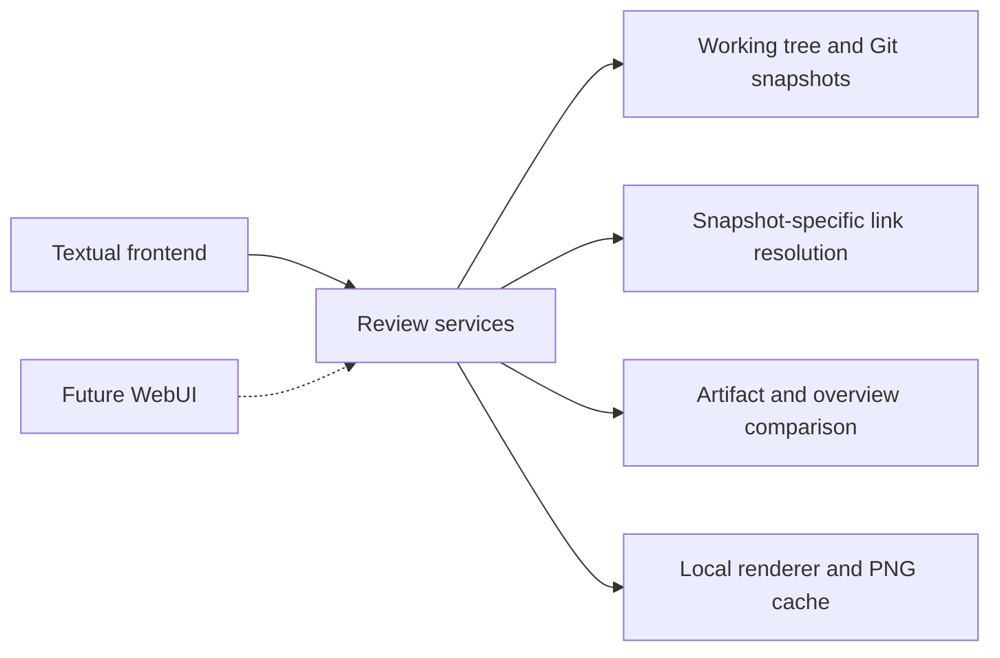
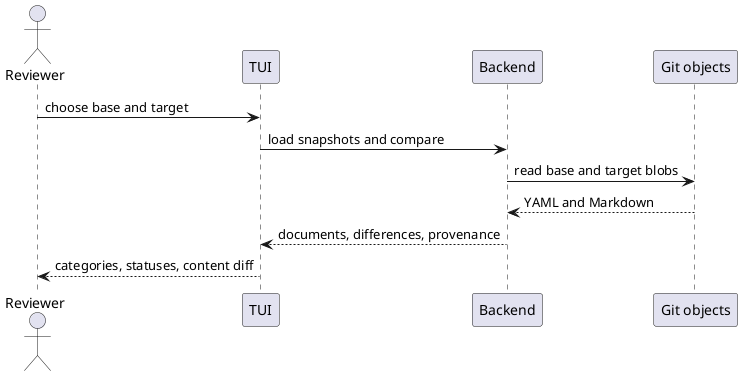

> GENERATED FILE — DO NOT EDIT.
> Source: spec/artifacts/. Regenerate with `uv run python scripts/generate_spec_views.py`.

# Design

## [DES-001](../artifacts/design/DES-001.yaml) — Reusable review backend and frontend boundary

### Description

The backend owns repository snapshots, canonical document models, relationship/link resolution, field comparisons, and diagram rendering. The terminal frontend owns layout, focus, selection, colors, dialogs, and Kitty image presentation. A future WebUI can adapt the same backend services without importing Textual into the backend.

The following sequence shows a commit comparison through the same boundary.

### Addresses

[REQ-016](../artifacts/requirements/REQ-016.yaml), [REQ-022](../artifacts/requirements/REQ-022.yaml), [REQ-023](../artifacts/requirements/REQ-023.yaml), [REQ-027](../artifacts/requirements/REQ-027.yaml), [REQ-028](../artifacts/requirements/REQ-028.yaml)

### Decisions

[ADR-001](../artifacts/decisions/ADR-001.yaml)

### Source

`spec/sources/chat.md` — [Approved implementation plan](provenance.md#approved-implementation-plan)

## [DES-002](../artifacts/design/DES-002.yaml) — Terminal review workspace

### Description

Use a main content pane on the left (approximately 75% width), an artifact list on the right, and scrollable category tabs along the bottom. Include Overviews, Diff, and Options. Render prose and headings with terminal Markdown styling. Support mouse selection, Tab and F6 focus movement, arrows, content scrolling, ID/title search, previous/next link selection, Enter activation, and navigation history. Status colors are supplemented by +, ~, and − markers.

### Addresses

[REQ-002](../artifacts/requirements/REQ-002.yaml), [REQ-003](../artifacts/requirements/REQ-003.yaml), [REQ-004](../artifacts/requirements/REQ-004.yaml), [REQ-005](../artifacts/requirements/REQ-005.yaml), [REQ-006](../artifacts/requirements/REQ-006.yaml), [REQ-007](../artifacts/requirements/REQ-007.yaml), [REQ-012](../artifacts/requirements/REQ-012.yaml), [REQ-013](../artifacts/requirements/REQ-013.yaml), [REQ-025](../artifacts/requirements/REQ-025.yaml)

### Decisions

[ADR-001](../artifacts/decisions/ADR-001.yaml)

### Source

`spec/sources/chat.md` — [Approved implementation plan](provenance.md#approved-implementation-plan)

## [DES-003](../artifacts/design/DES-003.yaml) — Revision selection and artifact comparison

### Description

Open a modal with searchable, paginated local Git history showing SHA, date, and subject. Select base and target separately, then Compare or Cancel. Read blobs without checkout. Match YAML artifacts by ID, compare typed field values, and compare overview Markdown text. List the union of documents and retain deleted items. Type changes affect both categories. Inline mode shows field and prose hunks; two-panel mode aligns rows in a shared scroll viewport. Carry snapshot provenance through content and links. Inline images come only from the target; removed diagram source stays readable.

### Addresses

[REQ-011](../artifacts/requirements/REQ-011.yaml), [REQ-012](../artifacts/requirements/REQ-012.yaml), [REQ-013](../artifacts/requirements/REQ-013.yaml), [REQ-014](../artifacts/requirements/REQ-014.yaml), [REQ-015](../artifacts/requirements/REQ-015.yaml), [REQ-018](../artifacts/requirements/REQ-018.yaml), [REQ-020](../artifacts/requirements/REQ-020.yaml), [REQ-022](../artifacts/requirements/REQ-022.yaml), [REQ-023](../artifacts/requirements/REQ-023.yaml)

### Decisions

[ADR-002](../artifacts/decisions/ADR-002.yaml), [ADR-005](../artifacts/decisions/ADR-005.yaml), [ADR-008](../artifacts/decisions/ADR-008.yaml)

### Source

`spec/sources/chat.md` — [Approved implementation plan](provenance.md#approved-implementation-plan)

## [DES-004](../artifacts/design/DES-004.yaml) — Description blocks and local diagram images

### Description

Extract interleaved prose, code, fenced Mermaid/PlantUML blocks, and raw standalone PlantUML blocks from descriptions. Read overview fences in the same way. Run local executables asynchronously with timeouts and cache PNG results by source, renderer identity/version, and configuration. Present them through Kitty graphics support and release uploaded images when content leaves the view. Disabled rendering shows source and invokes no renderers. Failed or unsupported rendering produces local diagnostics instead of stopping navigation. Persist rendering preferences in the user configuration directory and keep generated image caches outside the repository.

### Addresses

[REQ-008](../artifacts/requirements/REQ-008.yaml), [REQ-009](../artifacts/requirements/REQ-009.yaml), [REQ-010](../artifacts/requirements/REQ-010.yaml), [REQ-015](../artifacts/requirements/REQ-015.yaml), [REQ-021](../artifacts/requirements/REQ-021.yaml), [REQ-024](../artifacts/requirements/REQ-024.yaml), [REQ-028](../artifacts/requirements/REQ-028.yaml)

### Decisions

[ADR-001](../artifacts/decisions/ADR-001.yaml), [ADR-004](../artifacts/decisions/ADR-004.yaml), [ADR-006](../artifacts/decisions/ADR-006.yaml)

### Source

`spec/sources/chat.md` — [Approved implementation plan](provenance.md#approved-implementation-plan)

## [DES-005](../artifacts/design/DES-005.yaml) — Snapshot-specific link navigation

### Description

Index explicit artifact IDs, specification document paths, and source.file/source.section metadata within each snapshot. Follow direct canonical links first, then source metadata for retained legacy references. Offer a chooser when a source file maps to several artifacts. Resolve anchors in the relevant document or source section; explain missing targets. Removed links use the base snapshot, while added and unchanged links use the target. Preserve navigation history when moving between documents and versions.

### Addresses

[REQ-007](../artifacts/requirements/REQ-007.yaml), [REQ-019](../artifacts/requirements/REQ-019.yaml), [REQ-022](../artifacts/requirements/REQ-022.yaml), [REQ-025](../artifacts/requirements/REQ-025.yaml)

### Decisions

[ADR-003](../artifacts/decisions/ADR-003.yaml)

### Source

`spec/sources/chat.md` — [Approved implementation plan](provenance.md#approved-implementation-plan)

## [DES-006](../artifacts/design/DES-006.yaml) — Standalone package and self specification

### Description

Maintain a separately versioned Python package and a real submodule gitlink. Store this tool’s own canonical artifacts in spec/artifacts, provenance in spec/sources/chat.md, and derived review views in spec/generated. Regenerate those views explicitly using scripts/generate_spec_views.py. Launch with --repo . from the submodule to review its own specification; the default target remains the parent project. Trace requirements to use cases, decisions, designs, and acceptance scenarios.

### Addresses

[REQ-017](../artifacts/requirements/REQ-017.yaml), [REQ-026](../artifacts/requirements/REQ-026.yaml)

### Decisions

[ADR-007](../artifacts/decisions/ADR-007.yaml), [ADR-008](../artifacts/decisions/ADR-008.yaml)

### Source

`spec/sources/chat.md` — [Dogfooding](provenance.md#dogfooding)

## [DES-007](../artifacts/design/DES-007.yaml) — Browser frontend and GitHub repository providers

### Description

The Svelte WebUI is built to static assets and served by the read-only Python HTTP server. It consumes the existing snapshot and comparison services. The local provider reads the selected folder and Git history. GitHub access supports server-side GitHub App credentials (enumerating installations and minting short-lived installation tokens) or an existing authenticated GitHub CLI account (`gh auth login`). Both providers enumerate accessible repositories and read tree/blob snapshots through GitHub's API. The browser opens on a repository overview with a saved repository sidebar and an Add action. The overview presents open pull requests and available Actions checks. Selecting a repository or pull request opens the existing revision and comparison workspace. Saved repository selections are stored in browser-local settings. The browser selects repository revisions and renders snapshots and comparison results.

### Addresses

[REQ-034](../artifacts/requirements/REQ-034.yaml), [REQ-035](../artifacts/requirements/REQ-035.yaml), [REQ-016](../artifacts/requirements/REQ-016.yaml), [REQ-036](../artifacts/requirements/REQ-036.yaml)

### Decisions

[ADR-009](../artifacts/decisions/ADR-009.yaml)

### Source

`spec/sources/chat.md` — [WebUI and GitHub support](provenance.md#webui-and-github-support)
